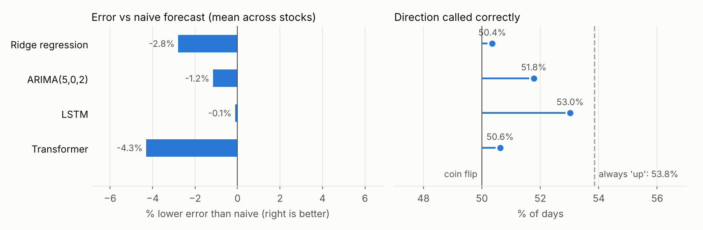

# Stock Forecasting: Transformer vs LSTM vs ARIMA, Backtested Honestly

Can deep learning predict tomorrow's stock return better than simply assuming no change? This project answers that with a leakage-free walk-forward backtest. It covers 10 large US technology stocks, five models and 2,260 out-of-sample forecasts per model, and it states plainly where the models fail.

Built as a team project for the Master of Data Science and Innovation at the University of Technology Sydney, then rebuilt as a tested Python package.



## Results

Walk-forward backtest from 28 May 2024 to 22 April 2025: 226 trading days × 10 stocks. Every model was retrained monthly (11 refits) on all data before the forecast window, and each forecast uses only information available at the previous close.

| Model | Mean abs. error (next close) | vs naive | Stocks where it beats naive | Direction correct |
|---|---:|---:|---:|---:|
| Naive (tomorrow = today) | 1.84% | | | |
| LSTM | 1.84% | -0.1% | 5 of 10 | **53.0%** (p = 0.002) |
| ARIMA(5,0,2) | 1.86% | -1.2% | 2 of 10 | 51.8% (p = 0.048) |
| Ridge regression | 1.89% | -2.8% | 0 of 10 | 50.4% |
| Transformer | 1.92% | -4.3% | 0 of 10 | 50.6% |

The error on the next close equals the error on the next-day return, so 1.84% means the forecast close was off by 1.84% of the price on an average day. The p-values test direction accuracy against a coin flip (one-sided binomial test).

**What this shows**

- **No model beats the naive forecast on average.** The LSTM ties it and wins on 5 of 10 stocks by under 1%. The Transformer is worst, overfitting about 230 training days per stock.
- **The LSTM calls direction better than chance (53.0%, p = 0.002), but not better than always predicting "up" (53.8%)** in a period when these stocks mostly rose. Its edge over a coin flip is mostly the market's upward drift.
- This is the expected result for daily prices of large, liquid stocks: most day-to-day movement is noise that price history can't explain. A model only earns its place if it beats these baselines out of sample, and none of these do convincingly.

Per-stock metrics are in [`reports/metrics_by_stock.csv`](reports/metrics_by_stock.csv) and the summary in [`reports/summary.csv`](reports/summary.csv).

### What changed from the first version

The original project evaluated one week of forecasts and reported about 1% error for each model. Rebuilding it found and fixed several issues:

| Issue | Fix |
|---|---|
| Feature and target scalers were fitted on the full dataset, including the validation period (look-ahead leakage). | Scalers are fitted inside each training window only, which a test checks. |
| The target was the intraday return (open to close) but was converted to a price from the previous close. | The target is now the close-to-close return, matching the price conversion. |
| One week of evaluation, with no baseline. | 2,260 forecasts per model with a walk-forward backtest, against naive and "always up" baselines, plus a significance test. |
| Raw price levels and price-to-index ratios were used as features. | Only stationary features (returns, ranges, volatility, RSI, volume z-score) are used. |
| Missing index data at the end of the dataset was forward-filled, which produced fake 0% market returns. | Gaps at the end are left empty, and those days are dropped. |
| Scripts ran on import and read hard-coded CSV paths. | An installable package with a CLI, a config file, tests and CI. |

## How it works

```text
data/finance_data.csv            daily OHLCV for 10 stocks, S&P 500, NASDAQ, analyst rating changes
        |
features.py      per-stock features known at the close of day t; target = return from t to t+1
        |
backtest.py      walk-forward: train on [start, t), forecast t ... t+20 one day ahead, refit, repeat
        |
models.py        naive | ridge | ARIMA(5,0,2) | LSTM | Transformer, all behind one fit/predict interface
        |
report.py        per-stock and summary metrics, significance test, chart
```

**Features (per stock):** 1-day return and four lags, intraday return, high-low range, 5- and 10-day momentum, 5- and 20-day volatility, 14-day RSI, 20-day volume z-score, S&P 500 and NASDAQ returns, return in excess of the S&P 500, analyst rating-change flag and day of week.

**Models:**

| Model | Setup |
|---|---|
| Naive | forecasts a 0% return, so tomorrow's close equals today's |
| Ridge | linear regression with L2 penalty (alpha 10) on the latest day's features |
| ARIMA | (5,0,2) on daily returns. Parameters are estimated on the training window and then filtered forward for one-step forecasts. |
| LSTM | 2 layers, 64 hidden units, 7-day input window |
| Transformer | 2 encoder layers, 4 heads, model dimension 64, learned positional embedding, 7-day window |

Both neural networks use Smooth L1 loss and Adam (learning rate 0.001), with early stopping on the last 15% of each training window. Seeds are fixed, so results are reproducible. All settings live in [`config.toml`](config.toml).

## How to run

Requires Python 3.11+.

```bash
pip install torch --index-url https://download.pytorch.org/whl/cpu   # CPU build, much smaller
pip install -e ".[dev]"

stock-forecast backtest                       # full backtest, about 6 minutes on a laptop CPU
stock-forecast backtest --models naive ridge arima --tickers AAPL NVDA   # quick run
stock-forecast predict                        # forecast the next trading day with every model
stock-forecast download                       # refresh data/finance_data.csv from Yahoo Finance
make test                                     # 21 tests, under 15 seconds
```

The committed dataset (May 2023 to April 2025) makes the results above reproducible offline. `download` replaces it with the latest two years.

## Testing and CI

GitHub Actions runs ruff, the test suite and a quick backtest on every push and pull request. The tests check that:

- shocking future prices never changes past features (no look-ahead),
- every model is trained only on rows before its forecast window, and scalers only see training rows,
- ARIMA one-step forecasts depend only on past returns,
- metrics match hand calculations, and every model fits and forecasts on synthetic data,
- on a pure random walk, no model beats naive by more than noise.

## Project structure

```text
├── stock_forecasting/
│   ├── data.py         load and download prices
│   ├── features.py     leakage-free features and target
│   ├── models.py       naive, ridge, ARIMA, LSTM, Transformer
│   ├── backtest.py     walk-forward backtest and metrics
│   ├── predict.py      next-day forecasts
│   ├── report.py       CSVs and chart
│   └── cli.py          stock-forecast command
├── config.toml         data, backtest and model settings
├── data/               committed price snapshot
├── reports/            backtest results
├── tests/
└── .github/workflows/ci.yml
```

## Next steps

- Add information that price history doesn't have, such as news sentiment or earnings dates, and test whether it beats the baselines.
- Forecast volatility instead of direction. It is far more predictable than returns and useful for risk sizing.
- Evaluate a trading rule after transaction costs, because a 53% hit rate can still lose money.

## Team

Abhishek Teotia (model development, feature engineering, forecasting workflow, evaluation and the production rebuild), with Muskan Choudhary, Justin Govanxa, Pai Ye, Jintian Liu and Yuzhong Wang.

For educational use only, not investment advice.
